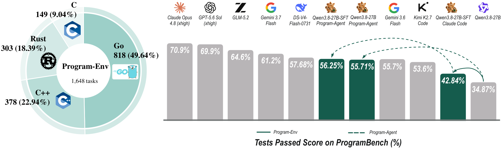
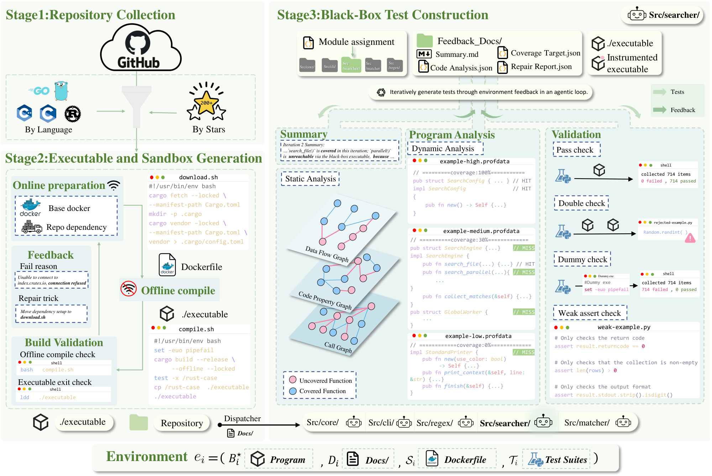
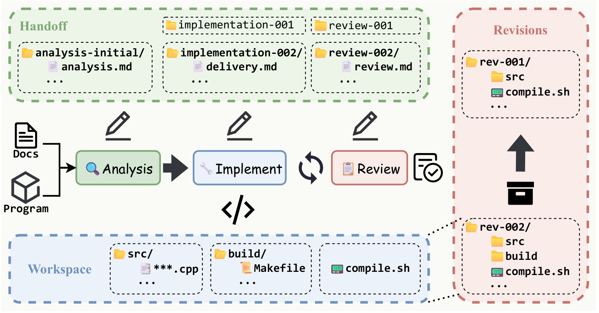

<div align="center">
  
  <h1>ProgramGym</h1>
  <h3>Scaling Training Environments for<br>Long-Horizon Program Reproduction Agents</h3>
  <p>
    <a href="https://arxiv.org/abs/2610.13395"></a>
    <a href="https://programgym.github.io/"></a>
    <a href="https://huggingface.co/datasets/ProgramGym/programgym-1648"></a>
    <a href="https://huggingface.co/ProgramGym"></a>
  </p>
  <p><b>1,648 verifiable environments · 4 programming languages · From exploration to implementation</b></p>
</div>

ProgramGym helps coding agents learn to **discover what a program does and rebuild it from scratch**. It combines **Program-Env**, a pipeline for constructing executable training environments from real repositories, with **Program-Agent**, a workflow for sustained exploration, implementation, and review.

This repository is the information hub for ProgramGym, with research highlights, figures, and links to project resources.

<p align="center">
  <a href="#news">News</a> ·
  <a href="#resources">Resources</a> ·
  <a href="#introduction">Introduction</a> ·
  <a href="#program-env">Program-Env</a> ·
  <a href="#program-agent">Program-Agent</a> ·
  <a href="#performance">Performance</a> ·
  <a href="#citation">Citation</a>
</p>

## News

- **2026-10-09:** The [ProgramGym preprint](https://arxiv.org/abs/2610.13395v1) is available on arXiv.

## Resources

| Resource | Description |
| :--- | :--- |
| [Paper](https://arxiv.org/abs/2610.13395) | Method, experimental protocol, results, and analysis |
| [Project website](https://programgym.github.io/) | Visual walkthrough of ProgramGym and its findings |
| [ProgramGym-1648 dataset](https://huggingface.co/datasets/ProgramGym/programgym-1648) | 1,648 program reproduction tasks constructed using the Program-Env pipeline |
| [Hugging Face](https://huggingface.co/ProgramGym) | ProgramGym organization and resource updates |

## Introduction

Reproducing a program requires more than implementing a supplied specification. An agent must explore a reference executable, infer its behavior, choose a software design, and iteratively build a working implementation.

ProgramGym addresses two challenges in this setting:

- **Constructing verifiable training environments at scale.** Program-Env builds reference executables and runtime sandboxes, then iteratively constructs behavioral tests with validation feedback.
- **Sustaining long-horizon development.** Program-Agent separates analysis, implementation, and review into distinct sessions, with persistent handoff records and validated revision checkpoints.

<p align="center">
  
</p>

## Program-Env

**From real repositories to interactive, verifiable training environments.** Each environment provides a reference executable, usage documentation, a runtime sandbox, and a black-box behavioral test suite.

<p align="center">
  
</p>

1. **Collect repositories.** Search by language and star-count buckets, deduplicate candidates, check licensing metadata, and anchor repositories to fixed commits.
2. **Build executable sandboxes.** Separate online dependency preparation from offline compilation; use build diagnostics to repair failed builds.
3. **Construct and validate tests.** Assign functional modules to parallel test-construction branches. Use program analysis and validation feedback to expand coverage and repair invalid, unstable, or weak tests.

Construction can use source code and program analysis. The reproduction agent receives documentation and execute-only access to the reference program, without reference source code or network access. Behavioral tests compare the candidate and reference programs through their external interfaces.

### Environment collection

Using the **Program-Env pipeline**, we constructed **1,648 program reproduction tasks**, available in the [**ProgramGym-1648 dataset** on Hugging Face](https://huggingface.co/datasets/ProgramGym/programgym-1648). The tasks span four programming languages:

| Language | Environments |
| :--- | ---: |
| Go | 818 |
| C++ | 378 |
| Rust | 303 |
| C | 149 |
| **Total** | **1,648** |

The collection spans **eight functional categories**. Test construction covers arguments, configuration, help, I/O, subcommands, and terminal user interfaces. Passing a finite test suite establishes agreement on the tested behaviors, rather than complete semantic equivalence.

## Program-Agent

**Explore, implement, review, and revise.** Program-Agent organizes development into role-isolated sessions and preserves behavioral evidence across iterations.

<p align="center">
  
</p>

- **Analysis:** Explore the reference program and record behavioral requirements before implementation.
- **Implementation:** Build and revise the reproduction using accumulated evidence and review feedback.
- **Review:** Check the implementation against observed behavior in a separate session and document remaining gaps.
- **Revision management:** Use offline compilation checks and validated checkpoints to support failure recovery.

## Performance

**Tests Passed** is the macro-average of per-task test pass rates. Program-Agent uses up to **five implementation rounds**.

| Model | Agent scaffold | Tests Passed (%) ↑ |
| :--- | :--- | ---: |
| Qwen3.8-27B | Claude Code | 34.87 |
| Qwen3.8-27B-SFT | Claude Code | 42.84 |
| Qwen3.8-27B | Program-Agent | 55.71 |
| **Qwen3.8-27B-SFT** | **Program-Agent** | **56.25** |
| DeepSeek-V4-Flash-0731 | Claude Code | 57.68 |
| DeepSeek-V4-Flash-0731 | Program-Agent | 58.97 |

Fine-tuning on trajectories from Program-Env improves Qwen3.8-27B by **7.97 percentage points** under Claude Code. Program-Agent improves the base model by **20.84 points** and the SFT model by **13.41 points** relative to their respective Claude Code results.

These scores measure test pass rates, not the percentage of fully reproduced programs. The paper reports Almost Resolved and Resolved separately, along with the evaluation settings and additional analyses.

## Citation

If you find ProgramGym useful in your research, please cite our paper:

```bibtex
@misc{yang2026programgym,
      title={ProgramGym: Scaling Training Environments for Long-Horizon Program Reproduction Agents},
      author={Chengyi Yang and Renxu Bao and Jue Hou and Zongpei Teng and Ziheng Wang and Yujie Lin and Chengsong Huang and Junnan Zhu and Delai Qiu and Yining Wang and Shengping Liu and Fei Long and Jinsong Su},
      year={2026},
      eprint={2610.13395},
      archivePrefix={arXiv},
      primaryClass={cs.SE},
      url={https://arxiv.org/abs/2610.13395},
}
```

## Contact

For research inquiries, contact [Chengyi Yang](mailto:yangchengyi@stu.xmu.edu.cn). You can also open an issue in this repository for questions or feedback.

## License

See [LICENSE](LICENSE) for this repository's MIT license. Refer to the respective resource pages for any separately distributed artifacts and their licenses.
